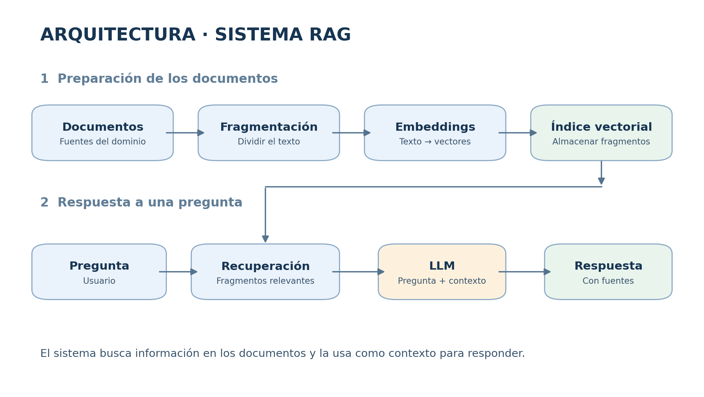
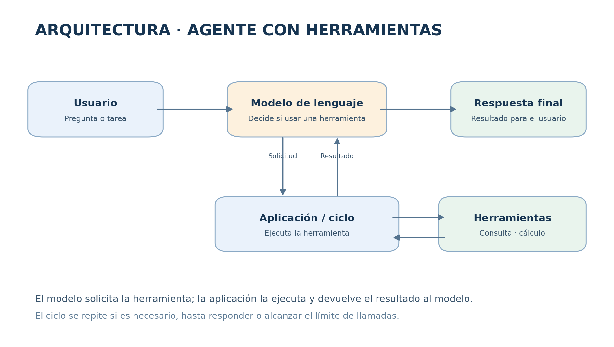

# Proyecto final — SI3003 Inteligencia Artificial

## 1. Propósito

Desarrollar un prototipo funcional que utilice un modelo de lenguaje para resolver un problema concreto. Cada equipo seleccionará **una** de estas alternativas:

- **Opción A: sistema RAG**, que responda preguntas usando documentos de un dominio específico.
- **Opción B: agente con herramientas**, que utilice funciones para obtener información o realizar operaciones necesarias para responder.

El proyecto debe tener un alcance pequeño y realizable con los materiales trabajados en clase. Se pueden adaptar los notebooks del curso: la contribución del equipo estará en la elección del problema, la adecuación de los datos o herramientas, las pruebas y el análisis de resultados.

## Fechas importantes

- **3 de noviembre de 2026 — Entrega de la propuesta:** presenten la conformación del equipo, una descripción del problema y los datos o documentos que utilizarán, incluyendo su origen o los enlaces de acceso. Indiquen también si eligieron RAG o agentes.
- **17 de noviembre de 2026 — Sustentaciones:** presenten y demuestren el prototipo, sus pruebas y resultados.

El profesor informará el medio y las condiciones logísticas de entrega.

## 2. Definición del problema

Antes de implementar, describan brevemente:

1. ¿Qué problema quieren resolver y para quién?
2. ¿Qué preguntas o tareas podrá atender el prototipo?
3. ¿Por qué eligieron RAG o un agente para ese problema?
4. ¿Qué queda por fuera del alcance?

Elijan un problema acotado. Por ejemplo, un asistente sobre un conjunto de reglamentos, una colección de artículos o un agente que consulte un catálogo y haga cálculos sencillos. No es necesario resolver un problema de producción.

## 3. Requisitos según la alternativa

### Opción A. Sistema RAG

Construyan un asistente que responda preguntas a partir de una colección de documentos elegida por el equipo.

1. Reúnan **al menos dos documentos** relacionados con el problema. Pueden ser PDF, texto u otros formatos que puedan procesar. Indiquen su origen y faciliten el acceso a ellos.
2. Extraigan el texto, divídanlo en fragmentos, generen embeddings y almacénenlos en un índice vectorial. Pueden usar las herramientas y el código de clase.
3. Ante una pregunta, recuperen fragmentos relevantes y utilícenlos como contexto para generar una respuesta con un LLM.
4. Muestren junto con la respuesta **la fuente de los fragmentos recuperados**, para que sea posible revisar en qué se apoyó.
5. Indiquen al sistema que reconozca cuando el contexto no es suficiente para responder. Verifiquen en las pruebas si realmente lo hace.

Pueden usar NVIDIA NIM, LangChain y Qdrant o FAISS, como en los ejemplos del curso, u otras herramientas equivalentes. No es necesario entrenar modelos ni construir un buscador vectorial desde cero.

### Opción B. Agente con herramientas

Construyan un agente que resuelva tareas de un dominio específico mediante un modelo de lenguaje y herramientas.

1. Definan **al menos dos herramientas** útiles para el problema, por ejemplo consultar un archivo o una tabla, buscar un dato en un catálogo o realizar un cálculo. Pueden ser funciones Python sencillas.
2. Describan al modelo qué hace cada herramienta y qué argumentos recibe. El agente debe poder seleccionar y solicitar la herramienta apropiada según la tarea.
3. Implementen o adapten el ciclo que ejecuta la herramienta solicitada, devuelve el resultado al modelo y produce la respuesta. Pueden partir del loop de clase o usar LangGraph.
4. Muestren en al menos dos pruebas la herramienta llamada, sus argumentos y el resultado devuelto, además de la respuesta final.
5. Definan un límite razonable de llamadas a herramientas y expliquen qué ocurre cuando se alcanza.

Las herramientas pueden trabajar con datos públicos o ficticios. No se exige conectarse a servicios externos ni desarrollar múltiples agentes. Un chatbot que solo responde sin usar herramientas no cumple esta alternativa.

## 4. Pruebas y análisis

Preparen **cinco casos de prueba** relacionados con el problema. Para cada uno registren la pregunta o tarea, el resultado esperado, la respuesta obtenida y una valoración breve de lo ocurrido. Incluyan:

- Tres casos habituales que el sistema debería resolver.
- Un caso que exija utilizar información de los documentos o una herramienta, según la opción escogida.
- Un caso límite: por ejemplo, información ausente, consulta ambigua o dato inexistente.

Puede existir solapamiento entre estas categorías. Comparen el resultado con los documentos o datos originales, según corresponda. En RAG revisen si la respuesta es relevante y está respaldada por los fragmentos recuperados; en agentes, si se seleccionó y ejecutó una herramienta adecuada y si la respuesta refleja su resultado. La evaluación puede ser **manual**: no se requiere implementar métricas automáticas ni usar un LLM como evaluador.

Describan al menos un error o limitación observado y una posible mejora. Si los cinco casos funcionan, incluyan el caso más difícil y expliquen qué limitación podría aparecer en otro escenario.

## 5. Entregables

Entreguen un enlace a un repositorio o una carpeta compartida con:

1. **Notebook o código ejecutable**, con las dependencias y configuración necesarias. Puede ejecutarse en Google Colab o localmente. Una interfaz gráfica es opcional.
2. **Documentos o datos de ejemplo** necesarios para ejecutar el prototipo, o enlaces e instrucciones claras para obtenerlos.
3. **README.md breve** que incluya integrantes, problema, opción elegida, instrucciones de ejecución, fuentes o herramientas utilizadas, los cinco casos y el análisis de resultados.

No incluyan claves de API en el código, notebooks ni repositorio. Expliquen cómo configurar la clave de forma privada, por ejemplo mediante los secretos de Colab o variables de entorno.

## 6. Sustentación

Durante la sustentación, el equipo debe explicar el problema, mostrar el funcionamiento del prototipo con ejemplos y presentar sus resultados y limitaciones. Todos los integrantes deben poder explicar las decisiones principales y el funcionamiento general del proyecto.

## 7. Criterios de evaluación

| Criterio | Peso | Qué se espera |
|---|---:|---|
| Problema y diseño | 20 % | Problema acotado y elección justificada de la alternativa. |
| Prototipo funcional | 35 % | Implementación de los requisitos de la opción elegida y funcionamiento en ejemplos pertinentes. |
| Pruebas y análisis | 25 % | Cinco casos documentados, revisión de resultados y reflexión sobre una limitación. |
| Entrega y sustentación | 20 % | Instrucciones claras para ejecutar, organización de archivos y explicación del trabajo. |
| **Total** | **100 %** | |

## 8. Material de apoyo

- [Notebooks de RAG — lecture10](https://github.com/EAFIT-IA/si3003-artificial-intelligence/tree/main/notebooks/lecture10), incluido el workshop sobre papers.
- [Notebooks de agentes — Lecture11](https://github.com/EAFIT-IA/si3003-artificial-intelligence/tree/main/notebooks/Lecture11), incluidos el loop, el agente con base de datos y el ejemplo con LangGraph.
- [Clase 10: RAG](https://eafit-ia.github.io/si3003-artificial-intelligence/slides/?p=clase10.md).
- [Clase 12: agentes](https://eafit-ia.github.io/si3003-artificial-intelligence/slides/?p=clase12.md).

