class: middle, center, title-slide

# SI3003 - Inteligencia Artificial

<div class="kicker">Clase 12 — Agentes con LLMs: del loop agéntico a LangGraph</div>

<br><br>

???

En la Clase 1 definimos un agente como algo que percibe y actúa. En las
últimas semanas construimos un LLM (Transformer) y le dimos acceso a
documentos externos (RAG). Hoy cerramos el círculo: convertimos el LLM
en la .bold[función de agente] de la Clase 1.

La tesis de la clase cabe en una frase: un agente con LLM no es un
modelo más inteligente, es un .bold[loop de control] escrito en Python
que llama al modelo, ejecuta lo que el modelo pide y le devuelve lo que
observó. Primero lo construimos a mano; al final vemos cómo LangGraph
expresa exactamente el mismo loop como un grafo.

---

class: middle, center

.width-90[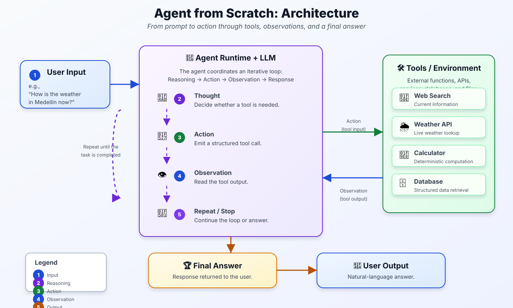]

???

Dejar la figura como mapa de la clase. Tres zonas: la entrada del
usuario, el runtime del agente (donde vive el loop) y el entorno
(herramientas). Las flechas Action / Observation son las mismas
flechas del diagrama agente–entorno de la Clase 1.

Lo único que hay que señalar ahora: el LLM nunca toca las herramientas.
Solo .italic[describe] la acción que quiere. Al final de la clase, cada
caja va a tener una línea de código asociada.

---

class: middle

# Agenda

<br>

## 1. De LLM a agente

## 2. El loop agéntico desde cero

## 3. Razonamiento: CoT, ReAct y ToT

## 4. Herramientas

## 5. LangGraph: el mismo loop como grafo

???

Bloques 1–2 son la parte central: formalizar y programar el loop. El
bloque 3 explica cómo se razona dentro del loop. El bloque 4 abre la
caja "Tools". El bloque 5 es ingeniería: la misma lógica con un
framework, para que entiendan qué está haciendo por debajo.

---

class: middle, center, divider-slide

## Parte 1 — De LLM a agente

---

class: smaller

# Repaso: el agente de la Clase 1

Un agente es una función que mapea la .bold[secuencia de percepciones]
a una acción:

$$
f: \mathcal{P}^{\ast} \rightarrow \mathcal{A}
$$

El programa del agente corre en un ciclo: percibir → decidir → actuar →
percibir el efecto.

.grid[
.kol-1-2[
.bold[Lo que ya teníamos:]

- Agentes reflejos, basados en modelo, en metas, en utilidad.
- MDPs y RL: la política $\pi(a \mid s)$ se .italic[calcula] o se .italic[aprende].
]
.kol-1-2[
.bold[Lo nuevo hoy:]

- La política es un .bold[LLM preentrenado].
- La percepción y la acción son .bold[texto] (mensajes y JSON).
- No entrenamos nada: el comportamiento se programa con el *prompt* y las herramientas.
]
]

???

Conectar explícitamente con la Clase 1: la definición de agente no
cambia. Lo que cambia es la implementación de $f$. En RL $f$ era una
tabla Q o una red entrenada con recompensas; aquí $f$ es un LLM que ya
sabe "razonar" en texto y al que le damos un menú de acciones.

Pregunta binaria para abrir: "¿un ChatGPT sin herramientas es un
agente según la definición de la Clase 1?" (Respuesta: es un agente
muy degenerado — su única acción es emitir texto y no observa
ningún efecto de esa acción).

---

class: smaller

# ¿Qué es un agente (con LLM)?

.alert[Una aplicación autónoma que persigue un objetivo .bold[observando]
el entorno y .bold[actuando] sobre él mediante herramientas.]

<br>

Combina tres cosas:

- .bold[Razonamiento]: el LLM decide qué hacer a continuación.
- .bold[Acción]: llamadas a herramientas (APIs, bases de datos, código).
- .bold[Información externa]: lo que devuelven esas herramientas entra al siguiente paso.

Puede planear y ejecutar tareas de varios pasos .bold[sin una instrucción humana en cada paso].

.footnote[Wiesinger, Marlow & Vuskovic, *Agents* (Google, 2024).]

???

La palabra clave es "en cada paso". Un chatbot responde un turno y
espera. Un agente puede encadenar decenas de decisiones antes de volver
al usuario. Eso trae poder y también riesgo (bucles infinitos, costos,
acciones irreversibles) — volveremos a esto.

---

class: smaller

# Modelos vs. agentes

| | .bold[Modelo (LLM)] | .bold[Agente] |
|---|---|---|
| Conocimiento | Limitado a los datos de entrenamiento | Ampliado con herramientas externas |
| Inferencia | Una sola predicción por consulta | Varias inferencias encadenadas, decididas por la capa de orquestación |
| Historial | No lo gestiona (es *stateless*) | Gestiona el historial de la sesión |
| Herramientas | No tiene implementación nativa | Integradas en la arquitectura |
| Lógica | La pone el usuario en el *prompt* (CoT, ReAct) | Arquitectura cognitiva nativa (CoT, ReAct, frameworks) |

.footnote[Adaptado de Wiesinger et al. (2024).]

???

Recorrer fila por fila, pero insistir en la de "Historial": el LLM es
estrictamente una función de su entrada. Toda la "memoria" que creemos
ver en un chat es el texto anterior que se le vuelve a enviar. Esto
va a ser central en la Parte 2.

---

class: middle, center

.width-80[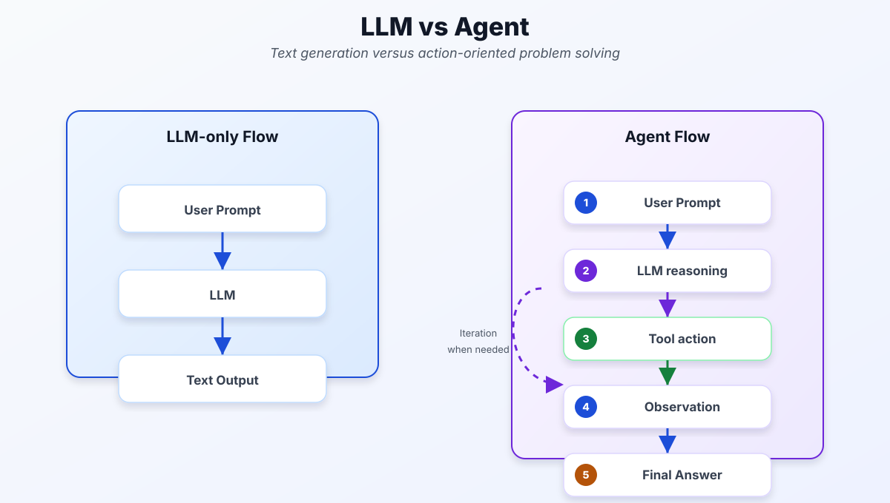]

???

El flujo LLM es una línea recta: prompt → LLM → texto. El flujo
agéntico tiene un ciclo: razonamiento → acción → observación →
razonamiento. Lo que convierte el LLM en agente no es un modelo
distinto, es ese lazo de retroalimentación, que vive .italic[fuera] del
modelo.

---

class: smaller

# Formalización: el LLM como política

Un LLM define una distribución autoregresiva sobre secuencias de tokens:

$$
p\_\theta(y \mid x) = \prod\_{k=1}^{|y|} p\_\theta(y\_k \mid x, y\_{<k})
$$

El agente mantiene un .bold[historial] $h\_t$ (el estado) y en cada paso:

$$
\begin{aligned}
a\_t &\sim \pi\_\theta(\cdot \mid h\_t) \equiv p\_\theta(\cdot \mid \text{prompt}(h\_t)) && \text{(el LLM elige una acción)} \\\\
o\_t &= E(a\_t) && \text{(el entorno / herramienta responde)} \\\\
h\_{t+1} &= h\_t \oplus a\_t \oplus o\_t && \text{(concatenación al historial)}
\end{aligned}
$$

con $h\_0 = (\text{system}, \text{user})$. Termina cuando $a\_t$ es una .bold[respuesta final] o cuando $t = T\_{\max}$.

???

Esto es exactamente el ciclo agente–entorno de la Clase 1 escrito con
la notación de RL de las Clases 4–5. Tres diferencias con un MDP:

1. El "estado" $h\_t$ es el historial completo (no hay supuesto de
   Markov sobre un estado compacto: el agente necesita toda la
   historia, que es justamente lo que le pasamos).
2. $\pi\_\theta$ no se entrena con recompensa en esta clase: viene
   fija del preentrenamiento + *instruction tuning*. Lo que nosotros
   diseñamos es $\text{prompt}(\cdot)$ y el conjunto de acciones.
3. $E$ es código Python: una API, una consulta SQL, una calculadora.

El operador $\oplus$ es literalmente `messages.append(...)`.

---

class: smaller

# El espacio de acciones

El LLM emite texto, pero la orquestación lo interpreta en dos tipos de acción:

$$
\mathcal{A} = \underbrace{\mathcal{A}\_{\text{tool}}}\_{\text{llamar herramienta}} \;\cup\; \underbrace{\mathcal{A}\_{\text{final}}}\_{\text{responder al usuario}}
$$

- $a\_t \in \mathcal{A}\_{\text{tool}}$: un objeto estructurado $(\texttt{name}, \texttt{args})$ → se ejecuta y se observa $o\_t$.
- $a\_t \in \mathcal{A}\_{\text{final}}$: texto libre → el episodio termina.

En la API (formato OpenAI) esa distinción llega como `finish_reason`:

| `finish_reason` | Acción | Qué hace el runtime |
|---|---|---|
| `"tool_calls"` | $a\_t \in \mathcal{A}\_{\text{tool}}$ | parsea, ejecuta, agrega `role: tool` |
| `"stop"` | $a\_t \in \mathcal{A}\_{\text{final}}$ | devuelve el texto |

???

Detalle de ingeniería: no todos los proveedores son consistentes con
`finish_reason`. Algunos modelos servidos vía endpoints
OpenAI-compatibles devuelven `"stop"` aunque traigan `tool_calls`. La
condición robusta es preguntar si `message.tool_calls` no está vacío.
Así lo implementamos en el código.

---

class: smaller

# Arquitectura cognitiva

.grid[
.kol-1-2[
.center.width-100[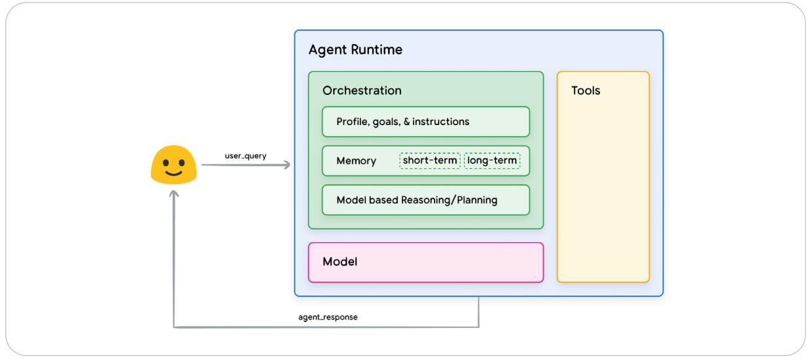]
]
.kol-1-2[
.bold[(1) Modelo:] el LLM que toma las decisiones. Puede ser general,
multimodal o ajustado (*fine-tuned*).

.bold[(2) Herramientas:] conectan el agente con el mundo exterior —
extensiones, funciones y almacenes de datos.

.bold[(3) Orquestación:] el ciclo que recibe información, razona,
decide y actúa; gestiona memoria (corto y largo plazo), estado y
planificación.
]
]

.footnote[Figura: Wiesinger et al., *Agents* (Google, 2024).]

???

En términos de la formalización anterior: el modelo es $\pi\_\theta$,
las herramientas son $E$, y la orquestación es el código que implementa
$\oplus$, la condición de parada y el formato del prompt. Memoria de
corto plazo = $h\_t$. Memoria de largo plazo = un almacén externo (lo
que vimos en RAG) consultado como herramienta.

---

class: middle, center, divider-slide

## Parte 2 — El loop agéntico desde cero

---

class: smaller

# El loop agéntico

.grid[
.kol-1-2[
.center.width-100[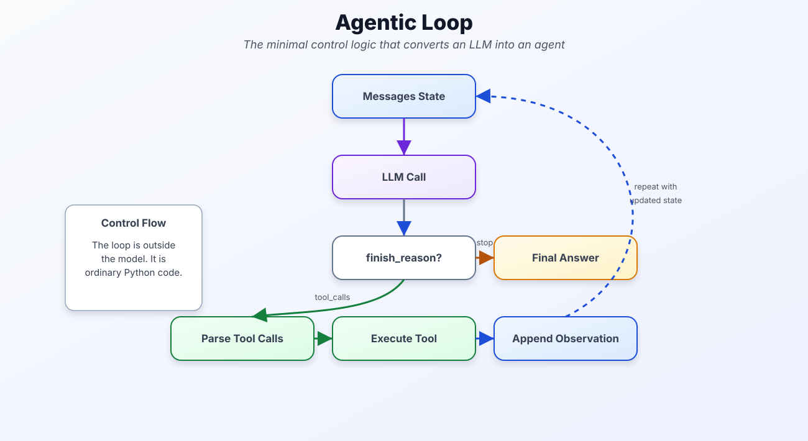]
]
.kol-1-2[
.compact-code[
```
function AGENTE(user, tools, T_max)
  h ← [system, user]
  for t = 1 to T_max do
    m ← LLM(h, tools)
    if m no tiene tool_calls then
      return m.content       # respuesta final
    h ← h ⊕ m                # registrar la intención
    for each (id, name, args) in m.tool_calls do
      o ← REGISTRY[name](args)
      h ← h ⊕ (tool, id, o)  # registrar la observación
  return FALLO("se agotaron las iteraciones")
```
]
]
]

???

Leer el pseudocódigo despacio, línea por línea, y señalar en la figura
dónde está cada línea.

Dos cosas que siempre se olvidan los estudiantes:

1. Hay que agregar al historial el mensaje del asistente .bold[con]
   los `tool_calls` antes de agregar los resultados. Si no, la API
   rechaza el mensaje `role: tool` porque no encuentra a qué llamada
   responde (el `tool_call_id`).
2. $T\_{\max}$ no es opcional. Sin él, un modelo que insiste en llamar
   herramientas genera un bucle infinito que además cuesta dinero.

---

class: smaller

# El mismo loop en Python

.compact-code[
```python
def run_agent(user_message, tools, registry, system, max_iter=10):
    messages = [{"role": "system", "content": system},
                {"role": "user",   "content": user_message}]
    for it in range(max_iter):
        resp = client.chat.completions.create(
            model=MODEL, messages=messages, tools=tools, tool_choice="auto")
        msg = resp.choices[0].message

        if not msg.tool_calls:                    # a_t ∈ A_final
            return msg.content

        messages.append(msg)                      # h ← h ⊕ a_t
        for tc in msg.tool_calls:                 # puede haber varias
            fn   = registry.get(tc.function.name)
            args = json.loads(tc.function.arguments)
            try:
                obs = fn(**args) if fn else f"Error: herramienta {tc.function.name} no existe"
            except Exception as e:
                obs = f"Error: {e}"               # el error también es observación
            messages.append({"role": "tool", "tool_call_id": tc.id,
                             "content": str(obs)})  # h ← h ⊕ o_t
    raise RuntimeError("max_iter alcanzado")
```
]

???

Este es el código del notebook, recortado a lo esencial. Funciona con
cualquier backend OpenAI-compatible (NVIDIA NIM, Groq, Ollama, OpenAI)
cambiando `base_url` y `MODEL`.

Señalar el `try/except`: un error de la herramienta .bold[no] debe
romper el loop. Se le devuelve al modelo como observación, y un buen
modelo corrige los argumentos y vuelve a intentar. Esto es una
decisión de diseño: el modelo es parte del manejo de errores.

---

class: smaller

# El historial de mensajes .italic[es] el estado

El LLM es .bold[stateless]: no recuerda nada entre llamadas. Toda la memoria del agente es la lista `messages` que se reenvía completa en cada iteración.

.grid[
.kol-1-2[
| Iteración | `messages` |
|---|---|
| 0 | `[system, user]` |
| 1 | `[…, assistant(tool_call)]` |
| 2 | `[…, tool(result)]` |
| 3 | `[…, assistant(final)]` |
]
.kol-1-2[
.center.width-100[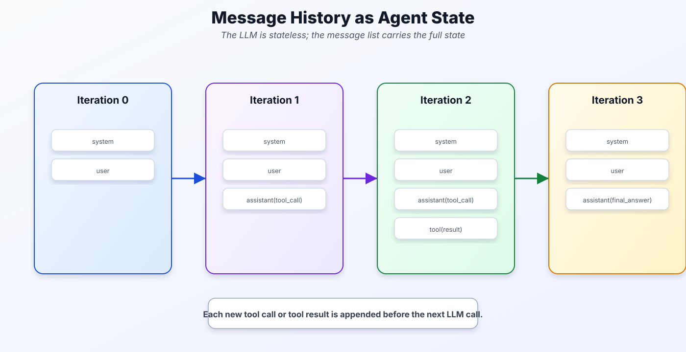]
]
]

.alert[Consecuencia: lo que no esté en `messages`, el agente no lo sabe.]

???

Experimento mental para el grupo: "si borro el mensaje `tool` de la
iteración 2 y vuelvo a llamar, ¿qué pasa?" — el modelo no tiene forma
de saber el resultado; o vuelve a pedir la herramienta, o alucina el
valor.

Esto también explica la memoria de largo plazo: no es "memoria del
modelo", es información externa que alguien vuelve a meter en
`messages`.

---

class: smaller

# El costo del loop crece cuadráticamente

Sea $L\_0$ la longitud (en tokens) del prompt inicial y $\Delta\_k = |a\_k| + |o\_k|$ lo que agrega la iteración $k$. La llamada $t$ procesa todo el historial:

$$
L\_t = L\_0 + \sum\_{k=0}^{t-1} \Delta\_k
$$

El costo total de un episodio de $T$ llamadas es

$$
C(T) = \sum\_{t=0}^{T-1} L\_t = T L\_0 + \sum\_{k=0}^{T-2} (T-1-k)\,\Delta\_k \;\overset{\Delta\_k = \Delta}{=}\; T L\_0 + \Delta\,\frac{T(T-1)}{2} = O(T^2)
$$

.bold[Ejemplo:] $L\_0 = 1000$, $\Delta = 1500$ (una búsqueda web), $T = 10$ → $C = 10\,000 + 1500 \cdot 45 = 77\,500$ tokens de entrada.

.footnote[Además el historial no puede superar la ventana de contexto del modelo (Clase 9): es un límite duro, no solo un costo.]

???

Derivar el segundo término en el tablero: el aporte $\Delta\_k$ se
vuelve a procesar en todas las llamadas posteriores a la iteración $k$,
es decir en $T-1-k$ llamadas. Sumando con $\Delta\_k$ constante,
$\sum\_{k=0}^{T-2}(T-1-k) = \sum\_{j=1}^{T-1} j = T(T-1)/2$.

Consecuencias de ingeniería que salen directo de la fórmula:
- Truncar la salida de las herramientas (reduce $\Delta$).
- Limitar $T\_{\max}$.
- Resumir el historial cuando $L\_t$ se acerca a la ventana.
- Separar en varios agentes con historiales cortos (Clase 13).

---

class: middle, center, divider-slide

## Parte 3 — Razonamiento: CoT, ReAct y ToT

---

class: smaller

# Chain-of-Thought (CoT)

Pedirle al modelo que escriba pasos intermedios $z$ antes de la respuesta $y$. La respuesta correcta es la que .bold[marginaliza] sobre los razonamientos:

$$
p\_\theta(y \mid x) = \sum\_{z} p\_\theta(y \mid x, z)\, p\_\theta(z \mid x)
$$

- .bold[CoT greedy]: genera un solo $z$ y responde condicionado a él — una muestra de la suma.
- .bold[Self-consistency]: muestrea $N$ razonamientos $z^{(i)} \sim p\_\theta(z \mid x)$ con temperatura $>0$, obtiene $y^{(i)}$ y vota:

$$
\hat{y} = \arg\max\_{y} \sum\_{i=1}^{N} \mathbf{1}\big[y^{(i)} = y\big] \;\approx\; \arg\max\_y p\_\theta(y \mid x)
$$

.footnote[Wei et al., *Chain-of-Thought Prompting Elicits Reasoning in LLMs* (2022); Wang et al., *Self-Consistency Improves CoT Reasoning* (2023).]

???

La votación es un estimador de Monte Carlo: la frecuencia de cada
respuesta entre las $N$ muestras converge a $p\_\theta(y \mid x)$ (ley
de los grandes números, la misma idea del muestreo directo de la Clase
6). Por eso self-consistency mejora la exactitud: estima el modo de la
distribución marginal en lugar de quedarse con un solo camino.

Costo: $N$ llamadas al LLM en vez de 1. En la práctica $N \approx 5$–$40$.

CoT por sí solo no usa herramientas: todo ocurre dentro del modelo.

---

class: smaller

# ReAct: razonar .bold[y] actuar

ReAct intercala pensamientos en lenguaje natural con acciones sobre el entorno. Amplía el espacio de acciones con el espacio del lenguaje $\mathcal{L}$:

$$
\hat{\mathcal{A}} = \mathcal{A} \cup \mathcal{L}, \qquad
o\_t = \begin{cases} E(a\_t) & a\_t \in \mathcal{A} \\\\ \varnothing & a\_t \in \mathcal{L} \;\text{(un pensamiento no cambia el entorno)} \end{cases}
$$

.grid[
.kol-1-2[
Traza típica:

.compact-code[
```
Question:  vuelo de Austin a Zúrich
Thought:   debo buscar vuelos
Action:    flights_tool
Action Input: Austin → Zurich
Observation: [lista de vuelos]
Thought:   debo presentarlos
Final Answer: estos son los vuelos…
```
]
]
.kol-1-2[
.center.width-100[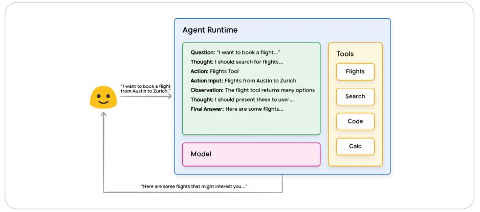]
]
]

.footnote[Yao et al., *ReAct: Synergizing Reasoning and Acting in Language Models* (ICLR 2023). Figura: Wiesinger et al. (2024).]

???

Por qué funciona: el pensamiento $a\_t \in \mathcal{L}$ no cambia el
entorno pero sí cambia $h\_{t+1}$, y por lo tanto cambia la
distribución de la siguiente acción. Es un "paso de cómputo" gratis
en el entorno (pero no en tokens).

Nuestro loop de la Parte 2 .italic[es] ReAct: con modelos modernos con
*function calling*, el "Thought" suele ir en `message.content` y la
"Action" en `message.tool_calls`. El formato de texto
Thought/Action/Observation de la traza es el original del paper, de
antes de que las APIs tuvieran tool calls nativos.

---

class: smaller

# Tree-of-Thoughts (ToT): razonar es buscar

Cada "pensamiento" parcial es un .bold[estado] en un árbol de búsqueda (Clase 2):

- .bold[Generador] $G(s) \rightarrow \lbrace s'\_1, \dots, s'\_k \rbrace$: el LLM propone $k$ continuaciones.
- .bold[Evaluador] $V(s) \in \mathbb{R}$: el LLM (u otra función) puntúa qué tan prometedor es $s$ — una heurística, como $h(n)$ en A\*.
- .bold[Búsqueda]: BFS con haz de ancho $b$ (beam search, Clase 3) o DFS con poda.

.compact-code[
```
function TOT-BFS(x, G, V, b, D)
  S ← {x}
  for d = 1 to D do
    S' ← ∪_{s ∈ S} G(s)                 # expandir
    S  ← los b estados de S' con mayor V  # podar
  return argmax_{s ∈ S} V(s)
```
]

.footnote[Yao et al., *Tree of Thoughts: Deliberate Problem Solving with LLMs* (NeurIPS 2023).]

???

Este es el puente más bonito del curso: la búsqueda local con haz de la
Clase 3, pero donde los sucesores los genera un LLM y la heurística
también. Nada nuevo algorítmicamente — lo nuevo es que el estado es
texto.

Costo: en cada nivel se hacen $b \cdot k$ generaciones y $b \cdot k$
evaluaciones, así que $O(b\,k\,D)$ llamadas al LLM. Por eso ToT se usa
en problemas cortos y difíciles (puzzles, planeación), no en un
chatbot.

---

class: smaller

# Comparación de técnicas de razonamiento

| Técnica | Estructura | Usa el entorno | Llamadas al LLM |
|---|---|---|---|
| CoT | Una cadena $z \rightarrow y$ | No | $1$ |
| Self-consistency | $N$ cadenas + votación | No | $N$ |
| ReAct | Cadena intercalada con acciones | Sí | $T$ (iteraciones del loop) |
| ToT | Árbol + búsqueda + heurística | Opcional | $O(b\,k\,D)$ |

<br>

.alert[Regla práctica: si la información necesaria está fuera del modelo, se necesita ReAct (herramientas). Si está dentro pero el razonamiento es difícil, CoT / self-consistency / ToT.]

???

Pregunta think-pair-share (1 minuto en parejas): "¿Cuál usarían para
(a) resolver un Sudoku, (b) saber el clima de mañana en Medellín,
(c) un problema de aritmética de 5 pasos?" — (a) ToT, (b) ReAct,
(c) CoT / self-consistency.

---

class: middle, center, divider-slide

## Parte 4 — Herramientas

---

class: smaller

# Las dos caras de una herramienta

.grid[
.kol-1-2[
.center.width-100[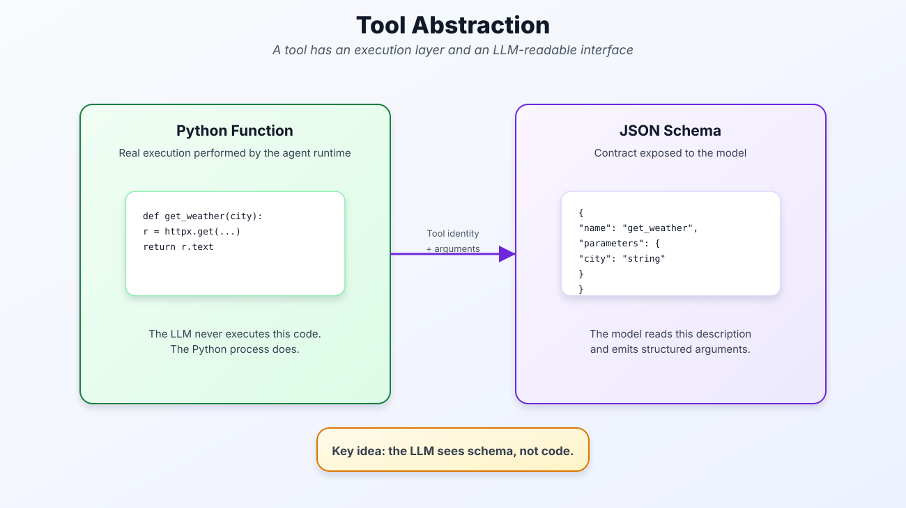]
]
.kol-1-2[
.compact-code[
```python
TOOLS = [{
  "type": "function",
  "function": {
    "name": "get_weather",
    "description": "Clima actual de una ciudad.",
    "parameters": {
      "type": "object",
      "properties": {
        "city": {"type": "string",
                 "description": "Ej: 'Medellín'"}},
      "required": ["city"]}}}]

def get_weather(city: str) -> str:
    url = f"https://wttr.in/{city}?format=3"
    return httpx.get(url).text

REGISTRY = {"get_weather": get_weather}
```
]
]
]

.alert[El LLM solo ve el .bold[esquema]. Nunca ve ni ejecuta el código.]

???

La `description` es parte del prompt: es lo único que el modelo sabe
sobre cuándo usar la herramienta. Una descripción ambigua produce un
agente que la usa cuando no debe (o nunca). Escribir descripciones es
ingeniería, no decoración.

Separación de responsabilidades: el modelo propone intenciones, el
código decide la ejecución. Por eso podemos validar, limitar o
rechazar cualquier llamada antes de ejecutarla.

---

class: smaller

# Una tool call es generación estructurada

El LLM genera la llamada token a token, como cualquier texto. La probabilidad de una llamada se factoriza en nombre y argumentos:

$$
p\_\theta(\texttt{name}, \texttt{args} \mid h\_t) = p\_\theta(\texttt{name} \mid h\_t)\;\prod\_{k} p\_\theta\big(\texttt{args}\_k \mid h\_t, \texttt{name}, \texttt{args}\_{<k}\big)
$$

Consecuencias de ingeniería:

- Nada garantiza que `args` sea JSON válido ni que cumpla el esquema → .bold[validar] antes de ejecutar (`json.loads`, tipos, campos `required`).
- El nombre puede no existir en `REGISTRY` → devolver el error como observación.
- Muchos proveedores aplican .bold[decodificación restringida]: en cada paso ponen $p\_\theta(y\_k \mid \cdot) = 0$ para los tokens que harían el JSON inválido según el esquema.

???

Esto conecta con la Clase 9: la cabeza de salida produce una
distribución sobre el vocabulario; la decodificación restringida
simplemente enmascara (pone logit $-\infty$) los tokens no permitidos
por una gramática antes del softmax y renormaliza. Es la misma
operación de máscara que en la atención causal.

Mensaje: el function calling no es magia de la API; es el mismo modelo
autoregresivo con un formato de salida acordado (y a veces una
máscara).

---

class: smaller

# Ciclo de vida de una tool call

.grid[
.kol-3-5[
.center.width-100[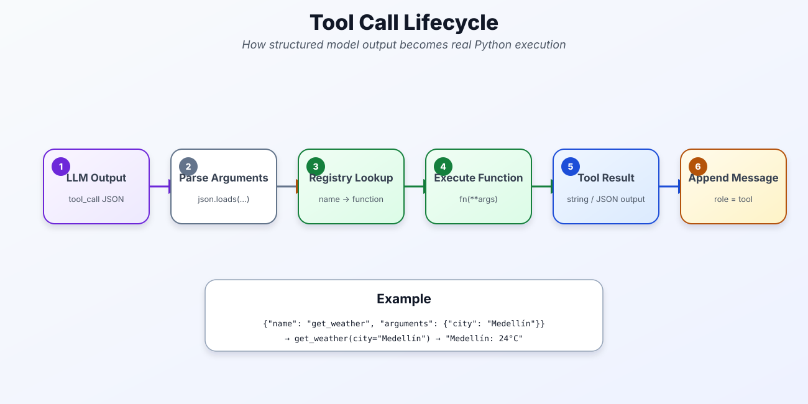]
]
.kol-2-5[
1. El LLM emite `tool_calls` (JSON).
2. Parsear: `json.loads(arguments)`.
3. Resolver: `REGISTRY[name] → fn`.
4. Ejecutar: `fn(**args)`.
5. Obtener el resultado (string).
6. Agregar `{"role": "tool", "tool_call_id": id, "content": …}`.
]
]

.compact-code[
```
LLM emite:     {"name": "get_weather", "arguments": "{\"city\": \"Medellín\"}"}
Runtime:       get_weather(city="Medellín")  →  "Medellín: 24°C, parcialmente nublado"
Historial:     {"role": "tool", "tool_call_id": "call_01", "content": "Medellín: 24°C, …"}
```
]

???

El `tool_call_id` es lo que permite tool calls paralelas: si el modelo
pide clima de Medellín y de Bogotá en el mismo mensaje, hay dos ids y
dos mensajes `tool`, y el modelo sabe cuál respuesta corresponde a
cuál pregunta.

---

class: smaller

# Tres tipos de herramientas

.grid[
.kol-1-2[
.bold[Extensiones] — el .bold[agente] llama directamente a la API externa. La extensión enseña al modelo cómo usarla (con ejemplos).

.center.width-100[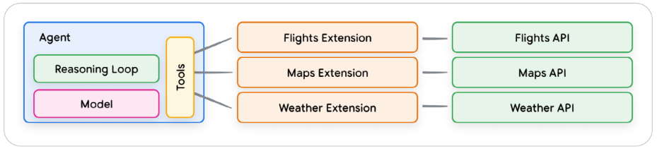]
]
.kol-1-2[
.bold[Funciones] — el modelo solo .bold[emite] la llamada (nombre + argumentos); la ejecución ocurre en el .bold[cliente].

.center.width-100[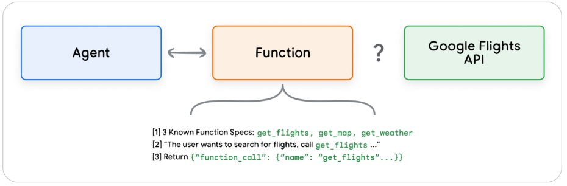]
]
]

.bold[Almacenes de datos] — acceso a información (documentos, web, tablas) vía embeddings: es RAG (Clase 10) usado como herramienta.

.footnote[Figuras: Wiesinger et al., *Agents* (Google, 2024).]

???

La distinción importante es .bold[dónde se ejecuta]. Con extensiones,
el runtime del agente tiene credenciales y llama la API. Con funciones,
el modelo solo devuelve JSON y es la aplicación cliente quien decide
si ejecuta. Nuestro `run_agent` es el caso "funciones": nosotros
somos el cliente.

---

class: smaller

# Extensión vs. función: ¿quién tiene el control?

.center.width-80[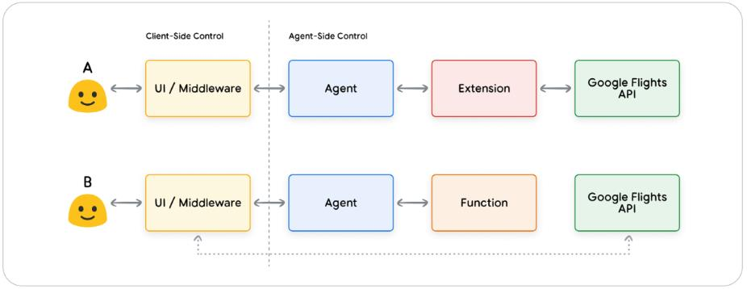]

.grid[
.kol-1-2[
.bold[A — Extensión (control del agente):] menos código en el cliente, pero el agente necesita credenciales y acceso de red.
]
.kol-1-2[
.bold[B — Función (control del cliente):] el cliente valida, filtra, pide confirmación humana o ejecuta en otro sistema antes de llamar la API.
]
]

???

Casos donde se prefieren funciones: la API no es accesible desde el
servidor del agente; hay que pedir confirmación humana antes de una
acción irreversible (pagar, enviar un correo, borrar); se quiere
procesar por lotes o asíncronamente; o simplemente seguridad
(el modelo nunca toca las credenciales).

---

class: middle, center, smaller

# Function calling paso a paso

.width-70[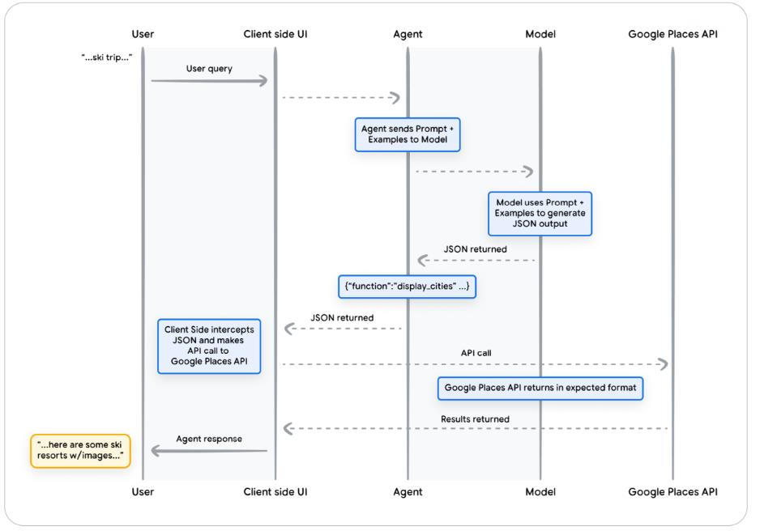]

???

Recorrer el diagrama de secuencia de arriba abajo. Lo importante: el
modelo devuelve JSON (`{"function": "display_cities", ...}`), el
cliente lo intercepta, hace la llamada a la API, y la respuesta vuelve
al modelo para que redacte la respuesta final. Es exactamente nuestro
`for tc in msg.tool_calls`.

---

class: smaller

# Almacenes de datos = RAG como herramienta

.grid[
.kol-1-2[
.center.width-100[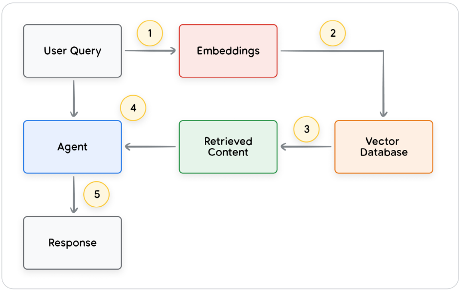]
]
.kol-1-2[
.bold[(1)] La consulta se convierte en embedding $\mathbf{q} = E(\text{query})$.

.bold[(2)] Se buscan los $k$ chunks más similares:

$$
\mathcal{R}\_k(\mathbf{q}) = \underset{c \in \mathcal{C},\ |\cdot| = k}{\operatorname{top-}k}\ \frac{\mathbf{q}^\top \mathbf{e}\_c}{\lVert\mathbf{q}\rVert\,\lVert\mathbf{e}\_c\rVert}
$$

.bold[(3)] El contenido recuperado vuelve al agente como .bold[observación] $o\_t$.

<br>

La diferencia con la Clase 10: aquí el .bold[agente decide] cuándo buscar y qué consulta escribir.
]
]

.footnote[Figura: Wiesinger et al. (2024).]

???

En RAG "clásico" el retrieval ocurre siempre, una vez, con la pregunta
literal del usuario. En RAG agéntico el modelo puede reformular la
consulta, buscar varias veces, o decidir que no necesita buscar. Mismo
retriever, distinta política.

---

class: smaller

# Ejemplo multi-paso: encadenar herramientas

.center.width-60[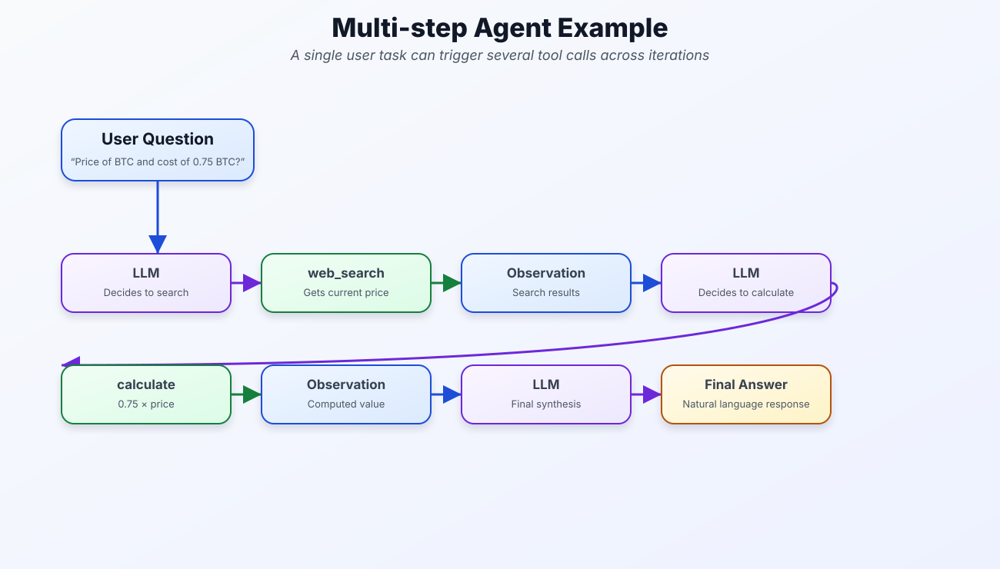]

.bold[Pregunta:] "¿Cuánto cuestan 0.75 BTC hoy?"
$\;\rightarrow\;$ `web_search("precio BTC")` $\;\rightarrow\;$ `calculate("0.75 * 94200")` $\;\rightarrow\;$ respuesta.

.alert[El agente no planea todo al inicio: en cada iteración decide el siguiente paso mirando $h\_t$.]

???

Preguntar: "¿por qué el agente no llama las dos herramientas en
paralelo?" — porque `calculate` depende del resultado de
`web_search`. Esa dependencia de datos es lo que fuerza la secuencia.
Esta idea (grafo de dependencias entre pasos) es la base de la Clase 13.

Por qué usar `calculate` en vez de dejar que el LLM multiplique: la
aritmética de un LLM es generación de tokens, no cómputo exacto.
Todo lo que se pueda calcular de forma determinista se delega a código.

---

class: middle, center

.width-80[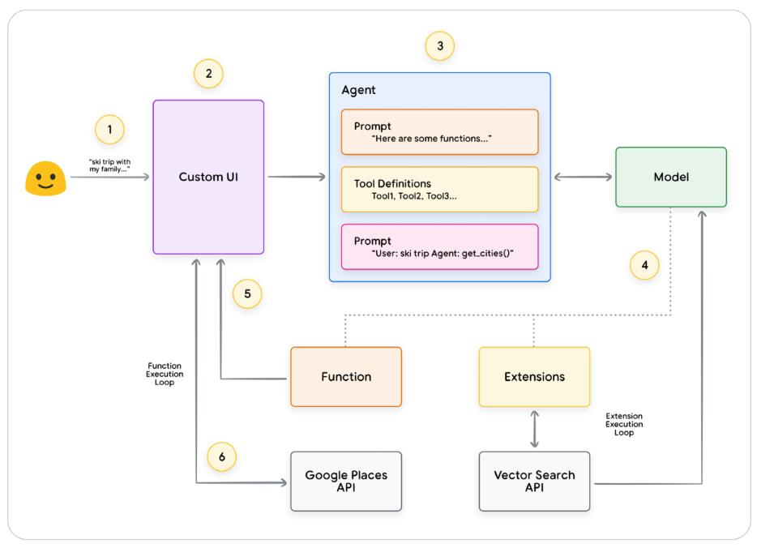]

.caption[Arquitectura general: UI, agente (prompt + definiciones de herramientas), modelo, funciones y extensiones. Wiesinger et al. (2024).]

???

Esta es la foto completa de un agente en producción. Recorrer los
números: (1) el usuario escribe en la UI; (2) la UI construye la
petición; (3) el agente arma el prompt con instrucciones y definiciones
de herramientas; (4) el modelo responde con una llamada; (5)–(6) la
función se ejecuta del lado del cliente, la extensión del lado del
agente, y el resultado vuelve al modelo.

---

class: middle, center, divider-slide

## Parte 5 — LangGraph: el mismo loop como grafo

---

class: smaller

# ¿Por qué un framework?

En el loop manual, el control de flujo .bold[está en el código] (`for`, `if`, `append`). En LangGraph, el control de flujo .bold[es la estructura de un grafo].

.center.width-80[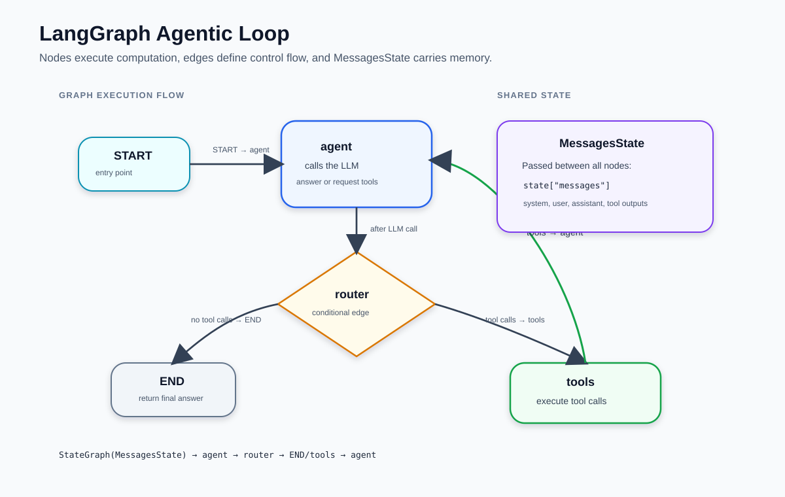]

???

Misma lógica ReAct, otra representación. Lo que se gana: el flujo se
puede inspeccionar, dibujar y extender (agregar un nodo de validación,
un paso de aprobación humana, varios agentes) sin reescribir la
función. Eso es justo lo que necesitamos para la Clase 13.

Mensaje honesto: para un agente de un solo loop, LangGraph es más
código que el `for`. El valor aparece cuando el grafo crece.

---

class: smaller

# Formalización: un grafo de estado

Un programa LangGraph es una tupla $(V, E, S, \oplus)$:

- $S$: el .bold[estado] (un `TypedDict`). Para un agente: $S = \lbrace \texttt{messages} \rbrace$.
- $V$: .bold[nodos], funciones $f\_v : S \rightarrow \Delta S$ que devuelven una .bold[actualización parcial].
- $\oplus$: el .bold[reducer] que combina estado y actualización: $S \leftarrow S \oplus f\_v(S)$.
- $E$: aristas fijas $u \rightarrow v$ y aristas .bold[condicionales] con un router $r: S \rightarrow V \cup \lbrace \texttt{END} \rbrace$.

Para `MessagesState`, el reducer es concatenación (`add_messages`):

$$
S.\texttt{messages} \leftarrow S.\texttt{messages} \oplus [m\_1, \dots, m\_j]
$$

.alert[Es exactamente $h\_{t+1} = h\_t \oplus a\_t \oplus o\_t$ de la Parte 1 — ahora lo hace el framework.]

???

Ésta es la lámina clave del bloque. Si entienden que un nodo devuelve
una .italic[actualización] y que el reducer la .italic[agrega], todo
LangGraph se vuelve predecible. Error típico: un nodo que devuelve la
lista completa de mensajes en lugar de solo los nuevos — con el reducer
de concatenación eso duplica el historial (en realidad `add_messages`
deduplica por id, pero no hay que depender de eso).

---

class: smaller

# Nodos como unidades de cómputo

.grid[
.kol-3-5[
.compact-code[
```python
@tool
def web_search(query: str) -> str:
    """Busca información actualizada en la web."""
    ...

TOOLS = [web_search, get_weather, calculate]
llm = ChatOpenAI(model=MODEL).bind_tools(TOOLS)

def agent_node(state: MessagesState) -> dict:
    sys = SystemMessage(SYSTEM_PROMPT)
    response = llm.invoke([sys] + state["messages"])
    return {"messages": [response]}  # parcial

tool_node = ToolNode(TOOLS)  # parsea, ejecuta, empaqueta
```
]
]
.kol-2-5[
.center.width-100[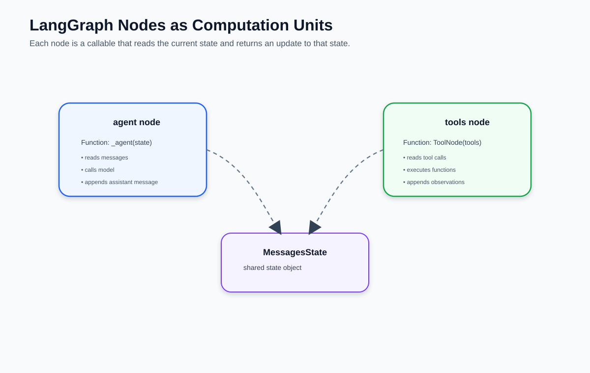]

- `agent`: lee `messages`, devuelve `[AIMessage]`.
- `tools`: lee el último `AIMessage`, devuelve `[ToolMessage, …]`.
]
]

???

`@tool` genera el JSON schema a partir de la firma y el docstring: la
misma información que en la Parte 4 escribíamos a mano. Por eso el
docstring es ahora parte del prompt — mismas reglas de calidad.

`ToolNode` hace las seis etapas del ciclo de vida de la tool call:
dispatch por nombre, `json.loads`, ejecución, empaquetado como
`ToolMessage` con el `tool_call_id` correcto, y tool calls paralelas.

---

class: smaller

# Router y construcción del grafo

.grid[
.kol-3-5[
.compact-code[
```python
def router(state: MessagesState):
    last = state["messages"][-1]
    return "tools" if last.tool_calls else END

builder = StateGraph(MessagesState)
builder.add_node("agent", agent_node)
builder.add_node("tools", tool_node)
builder.add_edge(START, "agent")
builder.add_conditional_edges("agent", router)
builder.add_edge("tools", "agent")   # el ciclo
graph = builder.compile()

out = graph.invoke(
    {"messages": [HumanMessage(q)]},
    config={"recursion_limit": 10})
```
]
]
.kol-2-5[
.center.width-100[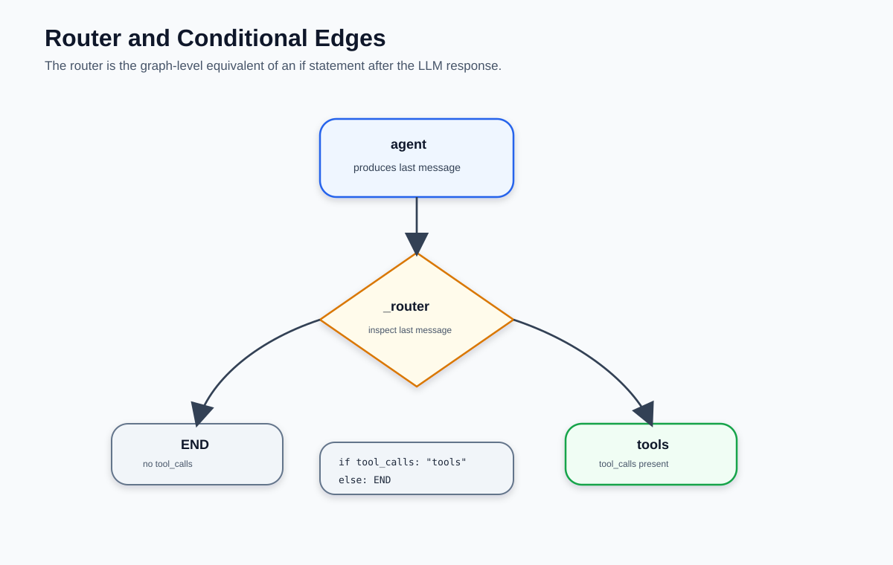]
]
]

.footnote[`recursion_limit` (default 25) cuenta pasos del grafo; al superarlo se lanza `GraphRecursionError`.]

???

Cada línea del loop manual tiene su equivalente:
- `if not msg.tool_calls: return` → el router devuelve `END`.
- el cuerpo del `for tc in tool_calls` → `ToolNode`.
- el `for it in range(max_iter)` → la arista `tools → agent` +
  `recursion_limit`.

Ojo: `recursion_limit` se pasa en el `config` al invocar, no en
`compile()`. Y cuenta .italic[pasos del grafo] (cada nodo ejecutado),
no iteraciones del loop: una iteración agent→tools son 2 pasos, así que
`recursion_limit=10` ≈ 5 iteraciones.

---

class: smaller

# Compilar, ejecutar e inspeccionar

.grid[
.kol-1-2[
.center.width-100[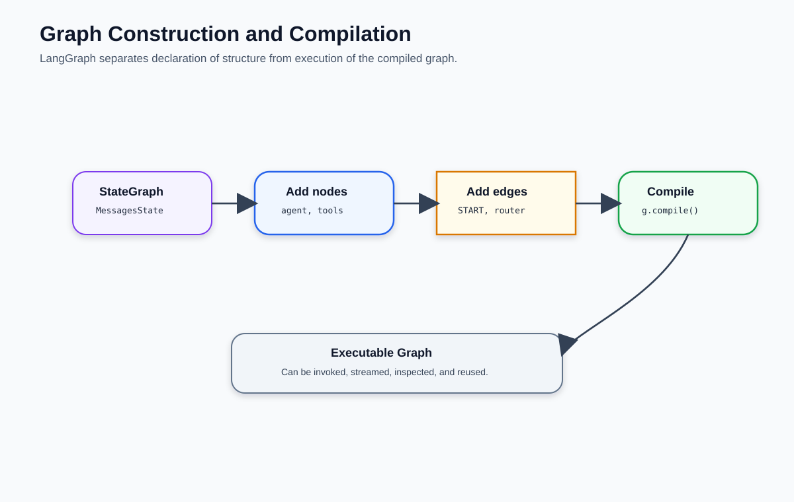]

`compile()` valida la estructura (nodos referenciados existen, hay camino desde `START`) y devuelve un objeto inmutable con `.invoke()`, `.stream()` y `.get_graph()`.
]
.kol-1-2[
.compact-code[
```python
# delta de cada nodo, en orden
for update in graph.stream(
        {"messages": [HumanMessage(q)]},
        stream_mode="updates"):
    for node, delta in update.items():
        print(node, "→", delta["messages"][-1])

# dibujar el grafo
graph.get_graph().draw_mermaid_png()
```
]

Salida típica: `agent → tools → agent → tools → agent → END`.
]
]

???

`stream_mode="updates"` es la mejor herramienta de depuración y de
enseñanza: muestra qué nodo corrió y qué agregó al estado. Es la
versión "gratuita" de los `print` que poníamos en el loop manual.

---

class: smaller

# Equivalencias: loop manual ↔ LangGraph

| Loop manual (Parte 2) | LangGraph |
|---|---|
| lista `messages` + `append` | `MessagesState` + reducer `add_messages` |
| `client.chat.completions.create(...)` | `agent_node` |
| `for tc in tool_calls: fn(**args)` | `ToolNode(TOOLS)` |
| `if not msg.tool_calls: return` | `router` + `add_conditional_edges` |
| `continue` del `for` | arista `tools → agent` |
| `range(max_iter)` | `config={"recursion_limit": …}` |
| JSON schema escrito a mano + `REGISTRY` | `@tool` (schema desde la firma y el docstring) |
| `print` en cada paso | `graph.stream(stream_mode="updates")` |

.alert[Mismo algoritmo, mismas herramientas, mismo modelo. Cambia dónde vive el control.]

???

Si un estudiante se lleva una sola lámina de la Parte 5, que sea esta.
La pregunta de examen natural: "dado este grafo de LangGraph, escribe
el loop equivalente en Python" (o al revés).

---

class: smaller

# Resumen

- Un .bold[agente con LLM] es el agente de la Clase 1 con $\pi\_\theta$ = un LLM: $a\_t \sim \pi\_\theta(\cdot \mid h\_t)$, $o\_t = E(a\_t)$, $h\_{t+1} = h\_t \oplus a\_t \oplus o\_t$.
- El .bold[loop agéntico] es código Python ordinario: llamar al LLM, si hay `tool_calls` ejecutarlas y agregar observaciones, si no, responder. $T\_{\max}$ es obligatorio.
- El LLM es .bold[stateless]: la memoria es la lista de mensajes. El costo de un episodio crece como $O(T^2)$ en tokens.
- .bold[CoT] marginaliza sobre razonamientos (self-consistency la estima por votación); .bold[ReAct] intercala pensamientos y acciones; .bold[ToT] convierte el razonamiento en búsqueda con heurística.
- Una .bold[herramienta] tiene dos caras: esquema JSON (lo que ve el modelo) y función (lo que ejecuta el runtime). La tool call es generación estructurada: hay que validarla.
- .bold[Extensiones] (ejecuta el agente), .bold[funciones] (ejecuta el cliente) y .bold[almacenes de datos] (RAG como herramienta).
- .bold[LangGraph] expresa el mismo loop como grafo $(V, E, S, \oplus)$: nodos que devuelven actualizaciones parciales, un reducer, y un router condicional.

---

class: middle, center, end-slide
count: false

## Fin de la Clase 12

Próxima clase: Sistemas multi-agente
